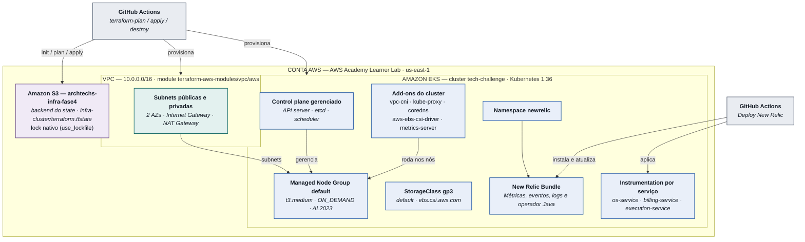

# fiap-fase3-infraestrutura

## Introdução

Infraestrutura compartilhada de OS, billing e execution. O Terraform em `infra/` provisiona um
cluster Kubernetes no Amazon EKS, VPC com subnets públicas/privadas, NAT Gateway, addons, managed
node group, além do recurso de cluster compartilhado StorageClass.

## Índice

- [SAGA da ordem de serviço](docs/saga.md)
- [Convenção de observabilidade](docs/convencao-observabilidade.md)
- [Validar os microsserviços no New Relic](k8s/newrelic/docs/validacao-execution.md)
- [Propósito](#propósito)
- [Tecnologias](#tecnologias)
- [Estrutura do repositório](#estrutura-do-repositório)
- [Arquitetura deste Repositório](#arquitetura-deste-repositório)
- [Pré-requisitos](#pré-requisitos)
- [Provisionar o ambiente](#provisionar-o-ambiente)
- [Regras de integração](#regras-de-integração)
- [Diagnóstico do cluster](#diagnóstico-do-cluster)
- [Conectar o kubectl ao cluster](#conectar-o-kubectl-ao-cluster)
- [Pipeline no GitHub Actions](#pipeline-no-github-actions)
- [Observabilidade](#observabilidade)
- [Integração com os outros repositórios](#integração-com-os-outros-repositórios)
- [Documentações do Projeto](#documentações)

---

## Propósito

- Provisionar o cluster Kubernetes completo no Amazon EKS (control plane, addons de rede e
  storage, managed node group) e a VPC em que ele roda via Terraform.
- Recursos compartilhados de cluster: cria a StorageClass `gp3` default e os addons
  que os workloads dependem (`aws-ebs-csi-driver` para PersistentVolumeClaims,
  `metrics-server` para HPA).
- Mensageria compartilhada dos microsserviços: tópicos SNS, filas SQS com DLQs e assinaturas (`infra/mensageria.tf`).
- Observabilidade compartilhada: coleta de métricas, eventos e logs do Kubernetes e auto-instrumentação Java com New Relic (`k8s/newrelic/`).
- Registro de imagens: **não** é provisionado aqui — cada serviço cria o próprio repositório Amazon ECR conforme necessário.

## Tecnologias

- Kubernetes 1.36
- Terraform >= 1.10.0; workflows com 1.14.0
- Componentes AWS:
  - EKS (cluster Kubernetes)
  - VPC (subnets públicas/privadas, Internet Gateway, NAT Gateway)
  - S3 (backend do Terraform)

## Estrutura do repositório

```
.github/workflows/  Terraform, recuperação dos nós e deploy do New Relic
k8s/newrelic/      bundle e auto-instrumentação Java dos três serviços
docs/             SAGA, convenção de observabilidade e arquitetura
infra/
├── versions.tf     bloco terraform{} — required_version, required_providers
├── backend.tf      bloco terraform{} — backend "s3"
├── providers.tf    providers aws e kubernetes
├── main.tf         VPC, EKS + addons, node group, StorageClass
├── mensageria.tf   tópicos SNS, filas SQS, DLQs e assinaturas dos 3 serviços
├── variables.tf    input variables
└── outputs.tf      contrato de integração com os outros repositórios
script-criar-backend.sh   bootstrap idempotente do bucket S3 do state (CI + uso manual)
```

## Arquitetura deste Repositório

Componentes provisionados por **este** repositório e como se relacionam com o restante do
projeto (pipeline que os cria, e os outros repositórios que os consomem):



## Pré-requisitos

- Terraform: >= 1.10.0
- kubectl: compatível com 1.36
- AWS CLI: v2

---

## Provisionar o ambiente

Os `.tf` ficam em `infra/`:

```bash
cd infra
terraform init
terraform fmt
terraform validate
terraform plan
terraform apply
```

## Regras de integração

Regras que os repositórios consumidores seguem ao ler os outputs deste módulo:

- **`key` distinta por repositório.** Todos usam o bucket `archtechs-infra-fase4`, mas cada root
  module precisa da própria chave como por exemplo: `database/terraform.tfstate`.
- **Não recrie a StorageClass.** Ela é criada aqui; use `local.infra.storage_class_name`.
  Cada repositório consumidor garante o namespace de seus workloads.
  Os seletores de auto-instrumentação estão em `k8s/newrelic/instrumentation.yaml`.

---

## Diagnóstico do cluster

```bash
kubectl get nodes -o wide
kubectl get pods -n kube-system
kubectl get storageclass
kubectl top nodes
kubectl get events -A --sort-by=.lastTimestamp | tail -30

aws eks describe-nodegroup --cluster-name tech-challenge --nodegroup-name default --region us-east-1
aws eks describe-addon --cluster-name tech-challenge --addon-name aws-ebs-csi-driver --region us-east-1
aws eks list-access-entries --cluster-name tech-challenge --region us-east-1
```

---

## Conectar o kubectl ao cluster

```bash
aws eks update-kubeconfig --region us-east-1 --name tech-challenge
kubectl get nodes
```

O mesmo comando sai pronto no output `configure_kubectl`.

### Acessar a aplicação da máquina local

O `kubectl port-forward` abre um túnel entre uma porta da sua máquina e um Service (ou pod) do
cluster — é o jeito de falar com a API sem depender do API Gateway.

Os nomes vêm do repositório da aplicação, não deste; confira os recursos publicados:

```bash
kubectl get deployment,service -A
```

```bash
# API do OS: porta 8080 do container -> 8080 na máquina local
kubectl port-forward -n os-service deployment/os-service 8080:8080
```

Com o port forward aberto, a API fica acessível na rota `http://localhost:8080`.

---

## Pipeline no GitHub Actions

| Workflow | Dispara em | O que faz |
| --- | --- | --- |
| `terraform-plan.yml` | Abertura de pull request para a `main`, ou manual | `fmt -check`, `init`, `validate`, `plan` |
| `terraform-apply.yml` | Push na `main` com mudanças em `infra/**` ou nos workflows Terraform, ou manual | `init`, `apply -auto-approve`, `output` |
| `terraform-destroy.yml` | só manual | exige a palavra `destroy` digitada, depois `destroy -auto-approve` |
| `recuperar-nos.yml` | só manual | recupera instâncias do node group que não se registraram no cluster (`infra/script-recuperar-nos.sh`) |
| `deploy-newrelic.yml` | só manual | atualiza os Secrets, instala o bundle Helm, aplica `Instrumentation` e valida os componentes |

Se o cluster estiver sem nós `Ready`, o workflow `recuperar-nos.yml` permite recuperar as instâncias que não se registraram. Ele usa as credenciais da sessão ativa da AWS.

Os workflows usam o Environment **`prod`**, com os seguintes secrets:

| Secret | Uso |
| --- | --- |
| `AWS_CREDENTIALS` | Credenciais temporárias para acesso à AWS e ao EKS. |
| `NEW_RELIC_LICENSE_KEY` | Chave de ingestão do New Relic usada pelo workflow de observabilidade. |

Formato de `AWS_CREDENTIALS`:

```text
aws_access_key_id=...
aws_secret_access_key=...
aws_session_token=...
```

A pipeline extrai `AWS_ACCESS_KEY_ID`, `AWS_SECRET_ACCESS_KEY` e `AWS_SESSION_TOKEN` desse conteúdo. As credenciais temporárias são substituídas no secret quando a sessão expira.

## Observabilidade

O workflow **Deploy New Relic** instala os coletores no namespace `newrelic` e aplica uma configuração Java por serviço. Os nomes no APM são `os-service`, `billing-service` e `execution-service`. Logs são coletados do stdout dos contêineres, enquanto o agente Java fornece transações, erros e traces.

A instrumentação ocorre na criação dos pods. O workflow do New Relic valida seus próprios componentes; a saúde e a recriação dos pods de aplicação pertencem ao deploy de cada serviço. A correlação da jornada usa `correlationId`, `orderId` e `eventId`, conforme a [convenção de observabilidade](docs/convencao-observabilidade.md).

---

## Integração com os outros repositórios

Os outputs de `infra/outputs.tf` expõem os identificadores dos recursos compartilhados para integração com os repositórios dos serviços e dos bancos de dados.

### Mensageria (SNS/SQS)

Cada serviço publica no seu tópico e consome uma fila por serviço de origem. Cada fila tem uma DLQ (`<fila>-dlq`, retenção de 14 dias, `maxReceiveCount` = `var.max_receive_count`) e só aceita mensagens do tópico de origem. As assinaturas usam `raw_message_delivery = true` (o consumidor lê o envelope JSON direto, sem o wrapper do SNS).

| Tópico (quem publica) | Filas assinadas (quem consome) |
| --- | --- |
| `os-events` (os-service) | `billing-service-os-events`, `execution-service-os-events` |
| `billing-events` (billing-service) | `os-service-billing-events`, `execution-service-billing-events` |
| `execution-events` (execution-service) | `os-service-execution-events`, `billing-service-execution-events` |

Os nomes são o contrato com os serviços (variáveis de ambiente dos ConfigMaps). As URLs e ARNs saem nos outputs `topicos_eventos_arn`, `filas_url` e `dlqs_url`. Os serviços **não** devem criar esses tópicos e filas: os nomes colidiriam com os daqui. Aplique este repositório antes de subir os serviços, que não iniciam sem as filas (`queue-not-found-strategy=fail`). O `destroy` deste repositório apaga a mensageria de todos os serviços.

Os eventos que passam por cada fila, a justificativa da coreografia e as ações compensatórias estão na [SAGA da ordem de serviço](docs/saga.md).

## Documentações

A documentação do projeto está organizada em:

- [SAGA](docs/saga.md): participantes, tópicos, filas, eventos e compensações
- [Convenção de observabilidade](docs/convencao-observabilidade.md): coleta, formatos de log e correlação
- [`ADR`](./docs/adr/): decisões de arquitetura
- [`Banco de Dados`](./docs/banco-de-dados/): Documentos do banco de dados (decisão e modelo de Entidade-Relacionamento)
- [`C4`](./docs/c4/): Diagrama do C4 Model
- [`RFC`](./docs/rfc/): RFCs do projeto
- [`Diagrama de Sequência`](./docs/sequencia/): Diagrama de Sequência
