# Diagrama de Arquitetura

Versão simplificada da visão macro da arquitetura de microsserviços da Fase 4 do Tech Challenge: OS, Billing e Execution, integrados por SAGA coreografada sobre SNS e SQS.

## Diagrama

```mermaid
flowchart TB
  classDef externo    fill:#E9ECF1,stroke:#5A6577,stroke-width:1.5px,color:#131A24
  classDef borda      fill:#FBF1E4,stroke:#A4611F,stroke-width:1.5px,color:#131A24
  classDef rede       fill:#E3F1EF,stroke:#1B6E68,stroke-width:1.5px,color:#131A24
  classDef k8s        fill:#E9EFF9,stroke:#2B5FA8,stroke-width:1.5px,color:#131A24
  classDef dados      fill:#F0EAF6,stroke:#6A4A85,stroke-width:1.5px,color:#131A24
  classDef mensageria fill:#FCEDEF,stroke:#B03A48,stroke-width:1.5px,color:#131A24

  pessoa["<b>Consumidor da API</b><br/><i>[Pessoa]</i><br/>Abre e acompanha ordens de serviço"]
  postman["<b>Postman</b><br/><i>[Cliente REST]</i><br/>Interage com a aplicação"]
  mp["<b>Mercado Pago</b><br/><i>[Sistema externo · pagamentos]</i><br/>Gera cobrança Pix com QR Code e notifica o pagamento por webhook"]
  newrelic["<b>New Relic</b><br/><i>[Sistema externo · observabilidade]</i><br/>Recebe events, traces e logs dos agentes APM"]

  subgraph aws["AWS"]
    direction TB

    apigw["<b>Amazon API Gateway</b><br/><i>[REST API - stage Prod]</i><br/>Porta de entrada única: /auth, /os, /billing e /execution"]
    ecr["<b>Amazon ECR</b><br/><i>[os-service · billing-service · execution-service]</i><br/>Um repositório de imagem Docker por serviço"]
    secrets["<b>AWS Secrets Manager</b><br/><i>[Credenciais dos bancos]</i><br/>Guarda usuário e senha dos RDS gerados pelo Terraform"]
    dynamo["<b>Amazon DynamoDB</b><br/><i>[NoSQL - tabela do billing-service]</i><br/>Orçamentos e pagamentos, com índice por paymentId"]

    subgraph msg["Mensageria - SNS e SQS"]
      direction TB

      snsos["<b>Tópico os-events</b><br/><i>[Amazon SNS]</i><br/>Recebe os eventos publicados pelo OS Service"]
      snsbill["<b>Tópico billing-events</b><br/><i>[Amazon SNS]</i><br/>Recebe os eventos publicados pelo Billing Service"]
      snsexec["<b>Tópico execution-events</b><br/><i>[Amazon SNS]</i><br/>Recebe os eventos publicados pelo Execution Service"]

      qos["<b>Filas do OS</b><br/><i>[Amazon SQS + DLQ]</i><br/>os-service-billing-events<br/>os-service-execution-events"]
      qbill["<b>Filas do Billing</b><br/><i>[Amazon SQS + DLQ]</i><br/>billing-service-os-events<br/>billing-service-execution-events"]
      qexec["<b>Filas do Execution</b><br/><i>[Amazon SQS + DLQ]</i><br/>execution-service-os-events<br/>execution-service-billing-events"]
    end

    subgraph vpc["VPC"]
      direction TB

      rota["<b>Roteamento de saída</b><br/><i>[Internet Gateway + NAT Gateway]</i><br/>Saída dos nós nas subnets privadas"]
      lambda["<b>AWS Lambda</b><br/><i>[Java 21]</i><br/>Autentica por CPF e emite o token JWT"]
      rdsos["<b>Amazon RDS do OS</b><br/><i>[PostgreSQL - porta 5432]</i><br/>Banco os_service, exclusivo do os-service"]
      rdsexec["<b>Amazon RDS do Execution</b><br/><i>[PostgreSQL - porta 5432]</i><br/>Banco execution_service, exclusivo do execution-service"]

      subgraph eks["AMAZON EKS - cluster tech-challenge - Kubernetes 1.36"]
        direction TB

        subgraph ng["Node Group - t3.medium - subnets privadas"]
          direction TB

          subgraph nsnr["Namespace newrelic"]
            direction TB
            nrbundle["<b>New Relic Bundle</b><br/><i>[Observabilidade]</i><br/>Agente para instrumentar os 3 serviços"]
          end

          subgraph nsos["Namespace os-service"]
            direction TB
            svcos["<b>Service do OS</b><br/><i>[LoadBalancer → 8080]</i><br/>Balanceia a carga entre os Pods do OS"]
            hpaos["<b>Horizontal Pod Autoscaler</b><br/><i>[min 2 · max 4 · CPU 70% e memória 80%]</i><br/>HPA do OS"]
            pdbos["<b>Pod Disruption Budget</b><br/><i>[minAvailable: 1]</i><br/>PDB do OS"]
            appos["<b>OS Service</b><br/><i>[Spring Boot]</i><br/>Jornada e histórico da OS, outbox e consumidores idempotentes"]
          end

          subgraph nsbill["Namespace tech-challenge"]
            direction TB
            svcbill["<b>Service do Billing</b><br/><i>[LoadBalancer → 8080]</i><br/>Balanceia a carga entre os Pods do Billing"]
            hpabill["<b>Horizontal Pod Autoscaler</b><br/><i>[min 2 · max 10 · CPU 70% e memória 80%]</i><br/>HPA do Billing"]
            pdbbill["<b>Pod Disruption Budget</b><br/><i>[minAvailable: 1]</i><br/>PDB do Billing"]
            appbill["<b>Billing Service</b><br/><i>[Spring Boot]</i><br/>Orçamento, pagamento e estorno, outbox e consumidores idempotentes"]
          end

          subgraph nsexec["Namespace execution-service"]
            direction TB
            svcexec["<b>Service do Execution</b><br/><i>[LoadBalancer → 8080]</i><br/>Balanceia a carga entre os Pods do Execution"]
            hpaexec["<b>Horizontal Pod Autoscaler</b><br/><i>[min 2 · max 4 · CPU 70% e memória 80%]</i><br/>HPA do Execution"]
            pdbexec["<b>Pod Disruption Budget</b><br/><i>[minAvailable: 1]</i><br/>PDB do Execution"]
            appexec["<b>Execution Service</b><br/><i>[Spring Boot]</i><br/>Diagnóstico, estoque e fila de execução, outbox e consumidores idempotentes"]
          end
        end
      end
    end
  end

  pessoa   -->|"<i>Usa</i>"| postman
  postman  -->|"<i>Chamadas na API</i><br/>[HTTPS - JSON]"| apigw
  mp       -->|"<i>Notifica o pagamento pela rota /billing</i><br/>[HTTPS - webhook]"| apigw

  apigw    -->|"<i>Autentica pela rota /auth</i><br/>[HTTP]"| lambda
  apigw    -->|"<i>Encaminha /os para o Service</i><br/>[HTTP]"| svcos
  apigw    -->|"<i>Encaminha /billing para o Service</i><br/>[HTTP]"| svcbill
  apigw    -->|"<i>Encaminha /execution para o Service</i><br/>[HTTP]"| svcexec
  lambda   -->|"<i>Consulta dados de usuário</i><br/>[JDBC :5432]"| rdsos

  svcos    -->|"<i>Balanceamento de carga</i><br/>[TCP]"| appos
  svcbill  -->|"<i>Balanceamento de carga</i><br/>[TCP]"| appbill
  svcexec  -->|"<i>Balanceamento de carga</i><br/>[TCP]"| appexec

  hpaos    -->|"<i>Escala os Pods</i><br/>[De 2 a 4]"| appos
  hpabill  -->|"<i>Escala os Pods</i><br/>[De 2 a 10]"| appbill
  hpaexec  -->|"<i>Escala os Pods</i><br/>[De 2 a 4]"| appexec
  pdbos    -->|"<i>Garante disponibilidade mínima</i><br/>[minAvailable: 1]"| appos
  pdbbill  -->|"<i>Garante disponibilidade mínima</i><br/>[minAvailable: 1]"| appbill
  pdbexec  -->|"<i>Garante disponibilidade mínima</i><br/>[minAvailable: 1]"| appexec

  appos    -->|"<i>Consulta dados da OS</i><br/>[JDBC :5432]"| rdsos
  appexec  -->|"<i>Consulta dados de execução</i><br/>[JDBC :5432]"| rdsexec
  appbill  -->|"<i>Consulta dados de billing</i><br/>[HTTPS - AWS SDK]"| dynamo
  appbill  -->|"<i>Cria cobrança Pix e solicita estorno</i><br/>[HTTPS - JSON]"| mp
  rdsos    -.->|"<i>Credenciais</i><br/>[Secrets Manager]"| secrets
  rdsexec  -.->|"<i>Credenciais</i><br/>[Secrets Manager]"| secrets

  appos    -.->|"<i>Publica eventos da OS</i><br/>[SNS Publish]"| snsos
  appbill  -.->|"<i>Publica eventos de billing</i><br/>[SNS Publish]"| snsbill
  appexec  -.->|"<i>Publica eventos de execução</i><br/>[SNS Publish]"| snsexec

  snsos    -.->|"<i>Assinatura da fila do Billing</i><br/>[raw message delivery]"| qbill
  snsos    -.->|"<i>Assinatura da fila do Execution</i><br/>[raw message delivery]"| qexec
  snsbill  -.->|"<i>Assinatura da fila do OS</i><br/>[raw message delivery]"| qos
  snsbill  -.->|"<i>Assinatura da fila do Execution</i><br/>[raw message delivery]"| qexec
  snsexec  -.->|"<i>Assinatura da fila do OS</i><br/>[raw message delivery]"| qos
  snsexec  -.->|"<i>Assinatura da fila do Billing</i><br/>[raw message delivery]"| qbill

  qos      -.->|"<i>Consome eventos</i><br/>[SQS Receive]"| appos
  qbill    -.->|"<i>Consome eventos</i><br/>[SQS Receive]"| appbill
  qexec    -.->|"<i>Consome eventos</i><br/>[SQS Receive]"| appexec

  appos    -.->|"<i>Fornece imagem do OS</i><br/>[docker pull]"| ecr
  appbill  -.->|"<i>Fornece imagem do Billing</i><br/>[docker pull]"| ecr
  appexec  -.->|"<i>Fornece imagem do Execution</i><br/>[docker pull]"| ecr
  rota     -.->|"<i>Saída para a internet</i><br/>[0.0.0.0/0]"| ng

  appos    -.->|"<i>Coleta dados de APM</i><br/>[events, traces e logs]"| nrbundle
  appbill  -.->|"<i>Coleta dados de APM</i><br/>[events, traces e logs]"| nrbundle
  appexec  -.->|"<i>Coleta dados de APM</i><br/>[events, traces e logs]"| nrbundle
  nrbundle -.->|"<i>Envia dados coletados ao New Relic</i><br/>[events, traces e logs]"| newrelic

  class pessoa,postman,mp,newrelic externo
  class apigw,lambda borda
  class rota rede
  class svcos,svcbill,svcexec,hpaos,hpabill,hpaexec,pdbos,pdbbill,pdbexec,appos,appbill,appexec,nrbundle k8s
  class ecr,rdsos,rdsexec,dynamo,secrets dados
  class snsos,snsbill,snsexec,qos,qbill,qexec mensageria
```

