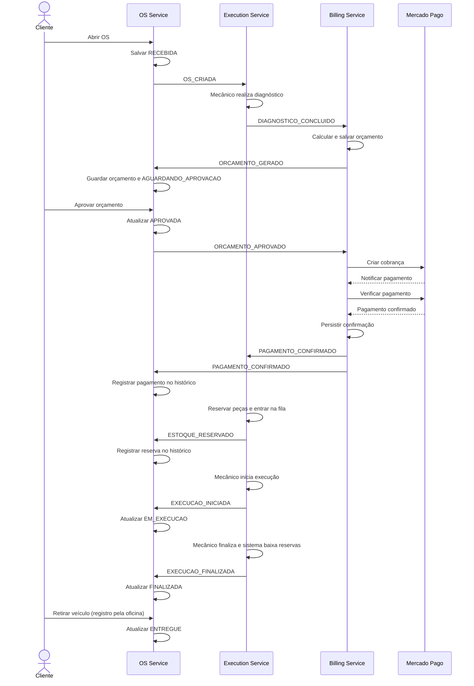
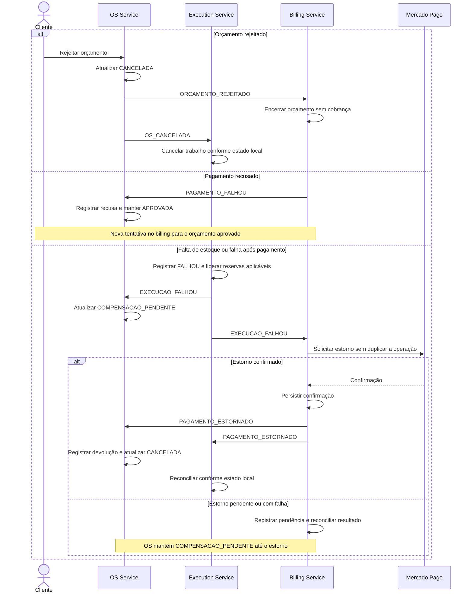

# SAGA da ordem de serviço

**Diretriz de implementação — 28/10/2026.**

## Organização

Usaremos **SAGA coreografada**: cada serviço processa eventos e publica seu resultado. Cada participante mantém seu próprio banco, sem acesso ao banco dos demais. OS cuida da jornada e do histórico; billing, de orçamento/pagamento/estorno; execution, de diagnóstico/estoque/execução.

O código e os contratos atuais do execution serão preservados. A infraestrutura encaminha sua saída `execution-events` para as filas corretas por uma Lambda de roteamento. Ela não decide etapas de negócio. OS e billing publicam diretamente nas filas de destino, conforme [decisões de integração](decisoes-integracao.md).

## Fluxo principal

**Evento é o fato comunicado; status é a situação persistida na OS.** As setas entre serviços representam mensagens SQS, incluindo o roteamento da saída do execution.

O orçamento depende do diagnóstico. Pagamento e reserva ficam registrados no histórico; não há status de estoque na OS. A ordem mostrada é lógica: os consumidores devem tratar reentregas e mensagens atrasadas sem regredir a situação da OS.

## Status da OS

| Situação | Status |
|---|---|
| OS aberta, ainda sem orçamento | `RECEBIDA` |
| Orçamento disponível para decisão | `AGUARDANDO_APROVACAO` |
| Aprovação registrada, aguardando pagamento ou execução | `APROVADA` |
| Recusa de pagamento ou pagamento/reserva antes da execução | Permanece `APROVADA`, com resultados no histórico |
| Execução iniciada / finalizada / veículo entregue | `EM_EXECUCAO` / `FINALIZADA` / `ENTREGUE` |
| Falha após pagamento, aguardando estorno | `COMPENSACAO_PENDENTE` |
| Orçamento rejeitado ou estorno concluído | `CANCELADA` |

`COMPENSACAO_PENDENTE` e `CANCELADA` são as únicas adições ao status do OS. `EM_DIAGNOSTICO` permanece compatível com o histórico do monólito, mas não será atualizado automaticamente nesta entrega: o execution não publica início de diagnóstico. Não será criado um evento adicional para isso. Os estados locais do execution permanecem intactos.

## Falhas e compensações

Compensação é uma ação local, como liberar reserva ou devolver pagamento. `PAGAMENTO_ESTORNADO` só é emitido com confirmação financeira. Billing recupera falhas do estorno; OS mantém a pendência até receber o resultado.

Os estados não precisam ser iguais: no execution, `FALHOU` pode permanecer assim após cancelamento/estorno. Não alterar esse comportamento para espelhar `CANCELADA` do OS. Expiração automática de orçamento e cancelamento manual após aprovação ficam fora desta entrega.

## Eventos e responsabilidade

| Serviço | Publica |
|---|---|
| OS | `OS_CRIADA`, `ORCAMENTO_APROVADO`, `ORCAMENTO_REJEITADO`, `OS_CANCELADA` |
| Billing | `ORCAMENTO_GERADO`, `PAGAMENTO_CONFIRMADO`, `PAGAMENTO_FALHOU`, `PAGAMENTO_ESTORNADO` |
| Execution, já implementado | `DIAGNOSTICO_CONCLUIDO`, `ESTOQUE_RESERVADO`, `EXECUCAO_INICIADA`, `EXECUCAO_FINALIZADA`, `EXECUCAO_FALHOU` |

Preservar o [envelope e os payloads do execution](https://github.com/theodirk21/tech-challenge-execution-service/blob/a938755/EVENTOS.md). OS e billing implementam outbox, entregas recuperáveis por destino e consumidores idempotentes, com `correlationId = String(osId)`. A implementação desses dois serviços e do roteamento ainda precisa ser concluída e validada.

As tarefas estão em [alinhamento de OS e billing](alinhamento-os-billing.md). A demonstração deve cobrir uma OS concluída e uma falha após pagamento com estorno, acompanhadas no New Relic.
