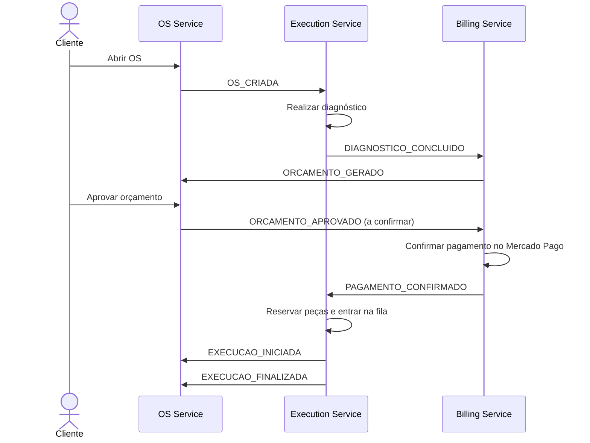
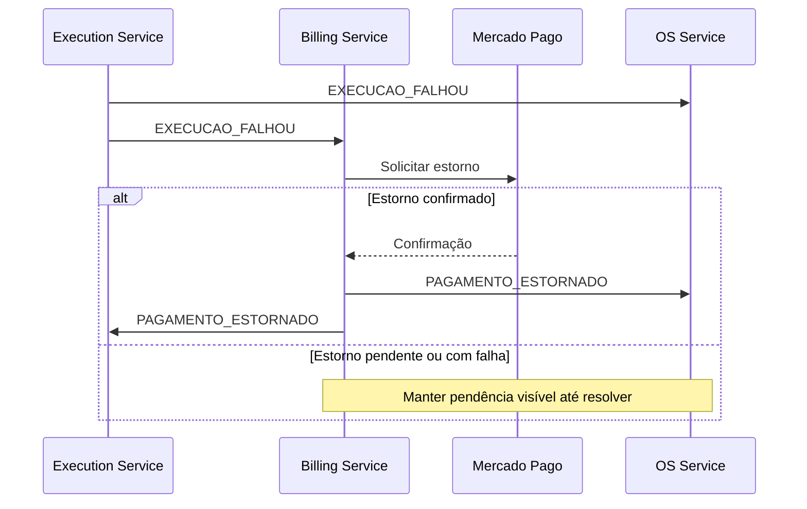

# SAGA da ordem de serviço

**Proposta para discussão do grupo — 27/10/2026.**

## Como vamos organizar

A proposta é usar **SAGA coreografada**: cada serviço recebe um evento, faz sua parte e publica o resultado. Como temos três serviços e o execution já usa SQS, podemos seguir esse modelo sem criar um orquestrador central.

| Serviço | Responsabilidade |
|---|---|
| OS | Abrir a OS, manter seu status e apresentar o histórico. |
| Billing | Gerar orçamento, receber pagamento e realizar estorno. |
| Execution | Fazer diagnóstico, reservar peças e executar o serviço. |

Cada serviço usa seu próprio banco. A comunicação ocorre por eventos, sem acesso ao banco de outro serviço.

## Fluxo principal

As setas entre serviços representam eventos pela mensageria. A entrada da aprovação pelo OS e o nome `ORCAMENTO_APROVADO` ainda precisam ser confirmados pelo grupo.

O orçamento é gerado **depois do diagnóstico**, pois depende das peças e serviços identificados pelo execution. A execução é iniciada e finalizada pelas ações do mecânico.

## Se alguma etapa falhar

Compensar significa executar uma ação que corrige o efeito anterior, como liberar uma reserva ou estornar um pagamento. Cada serviço faz sua compensação local.

| Situação | Tratamento proposto |
|---|---|
| Orçamento rejeitado ou expirado | Encerrar a OS e cancelar o trabalho pendente. |
| Pagamento recusado | Registrar a recusa e aplicar a política de nova tentativa ou cancelamento, a combinar. |
| Falta de estoque ou falha na execução após pagamento | Execution publica `EXECUCAO_FALHOU`, libera reservas aplicáveis e billing solicita estorno. |
| Estorno ainda não confirmado | Manter a pendência visível. Não informar que o dinheiro já foi devolvido. |

A situação da OS enquanto o estorno está pendente ainda precisa ser definida. Os estados locais podem ser diferentes: no execution, um item em `FALHOU` não muda automaticamente para `CANCELADA` ao receber cancelamento.

## Cuidados básicos na implementação

- Manter alteração de negócio e evento na mesma transação local usando **outbox**.
- Usar `eventId` para evitar repetir efeitos quando uma mensagem for entregue novamente. O SQS também pode entregar mensagens fora de ordem.
- Usar `correlationId = String(osId)` para encontrar a mesma OS nos três serviços.
- Tratar falhas de processamento e encaminhar mensagens não resolvidas para uma **DLQ**, permitindo diagnóstico e nova tentativa.

O execution já possui outbox e controle de eventos processados. Isso ainda precisa ser adotado e validado na integração com os demais serviços.

Os payloads de referência estão no [EVENTOS.md do execution](https://github.com/theodirk21/tech-challenge-execution-service/blob/a938755/EVENTOS.md). O roteamento para todos os consumidores ainda está em aberto.

Para a demonstração, precisamos mostrar uma OS concluída e outra com falha seguida de compensação, acompanhando ambas pelos logs. Antes disso, alinhar as [decisões pendentes](decisoes-pendentes.md).
