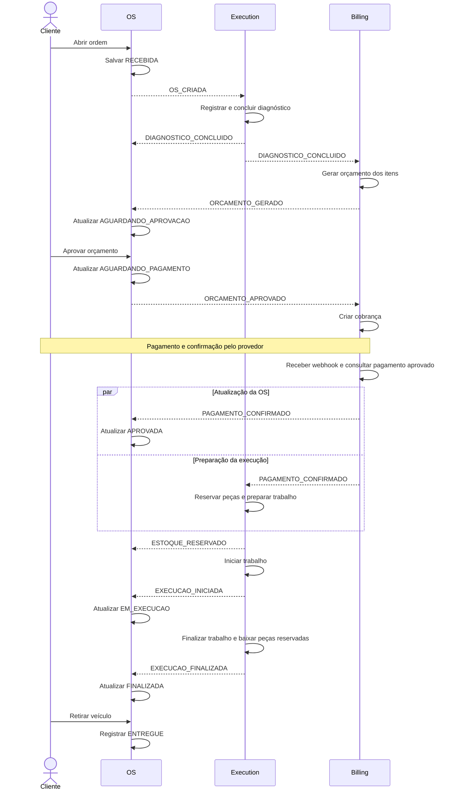

# SAGA da ordem de serviço

A integração entre `os-service`, `execution-service` e `billing-service` usa SAGA coreografada. Cada serviço mantém seus próprios dados e reage a eventos publicados em tópicos SNS e entregues por filas SQS.

| Serviço | Responsabilidade |
|---|---|
| OS | Abertura, aprovação, estado e histórico da ordem de serviço. |
| Execution | Diagnóstico, reserva de peças, fila de trabalho e execução. |
| Billing | Orçamento, cobrança, pagamento e compensação financeira. |

## Por que SAGA coreografada

A jornada da OS atravessa três serviços com persistências independentes e inclui etapas demoradas, como aprovação do cliente, pagamento e execução do trabalho. A SAGA permite encadear essas etapas por eventos e compensar seus efeitos quando há falhas, sem manter uma transação de banco aberta durante toda a jornada.

Escolhemos a coreografia porque:

- **As responsabilidades estão bem delimitadas.** Cada serviço decide como reagir aos eventos do seu domínio e publica o resultado, sem um coordenador central de etapas.
- **São apenas três participantes.** O fluxo permanece compreensível com o contrato de eventos e a matriz de filas deste documento, aproveitando a integração SNS/SQS do projeto.
- **Os serviços operam de forma independente.** As filas armazenam mensagens durante indisponibilidades dos consumidores e permitem retomar o processamento por reentrega.

O SNS distribui mensagens; as decisões de negócio ficam nos serviços. O OS registra a jornada, mas não comanda o processamento interno dos demais participantes. Adotamos consistência eventual: publicação, consumo e compensação ocorrem em momentos diferentes, acompanhados por `correlationId` e `eventId`. [Referência do padrão](https://docs.aws.amazon.com/prescriptive-guidance/latest/cloud-design-patterns/saga-choreography.html).

## Tópicos, filas e eventos

Cada serviço publica exclusivamente no seu tópico. O SNS entrega todos os eventos do produtor às duas filas assinantes, sem filtro por tipo. As filas seguem `<consumidor>-service-<produtor>-events`; o consumidor lê `type` para selecionar o tratamento de negócio.

| Produtor | Tópico SNS | Fila SQS | Consumidor | Eventos com tratamento de negócio |
|---|---|---|---|---|
| OS | `os-events` | `execution-service-os-events` | Execution | `OS_CRIADA`, `OS_CANCELADA` |
| OS | `os-events` | `billing-service-os-events` | Billing | `ORCAMENTO_APROVADO`, `ORCAMENTO_REJEITADO`, `OS_CANCELADA` |
| Billing | `billing-events` | `os-service-billing-events` | OS | `ORCAMENTO_GERADO`, `PAGAMENTO_CONFIRMADO`, `PAGAMENTO_FALHOU`, `PAGAMENTO_ESTORNADO` |
| Billing | `billing-events` | `execution-service-billing-events` | Execution | `PAGAMENTO_CONFIRMADO`, `PAGAMENTO_FALHOU`, `PAGAMENTO_ESTORNADO` |
| Execution | `execution-events` | `os-service-execution-events` | OS | `DIAGNOSTICO_CONCLUIDO`, `ESTOQUE_RESERVADO`, `EXECUCAO_INICIADA`, `EXECUCAO_FINALIZADA`, `EXECUCAO_FALHOU` |
| Execution | `execution-events` | `billing-service-execution-events` | Billing | `DIAGNOSTICO_CONCLUIDO`, `EXECUCAO_FALHOU` |

Por exemplo, `OS_CRIADA` chega ao execution e ao billing; a geração do orçamento no billing começa com `DIAGNOSTICO_CONCLUIDO`. A tabela descreve os tratamentos de negócio, não filtros de assinatura.

Cada fila possui uma DLQ com sufixo `-dlq`, retenção de 14 dias e limite padrão de cinco recebimentos antes do redirecionamento. As assinaturas usam `raw_message_delivery=true`: o corpo recebido é o envelope JSON, sem wrapper do SNS. Recursos e assinaturas ficam em [mensageria.tf](../infra/mensageria.tf).

## Envelope e consistência

O envelope v1 contém `eventId`, `type`, `version`, `occurredAt`, `correlationId` e `payload`. `payload.osId` identifica a ordem; `correlationId` contém o mesmo ID como texto. `DIAGNOSTICO_CONCLUIDO` inclui `payload.itens`, com `tipo`, `refId` e `quantidade`, usados para montar o orçamento.

Cada evento recebe seu próprio UUID em `eventId`, preservado nas reentregas. Os serviços mantêm outbox para os eventos de saída e registros dos eventos processados para identificar duplicidades. As filas Standard permitem duplicação e entrega fora de ordem. Não há transação global nem ordenação entre as filas dos diferentes participantes.

## Fluxo principal

As setas entre serviços representam eventos entregues via SNS → SQS. As ações do cliente e as operações de diagnóstico e execução entram pelas APIs dos serviços responsáveis.

Diagnóstico e reserva são eventos informativos no histórico do OS. A confirmação de pagamento chega ao OS e ao execution de forma independente. A retirada do veículo é uma operação local do OS, sem evento de integração.

## Falhas e compensações

Cada participante compensa os efeitos nos próprios dados. Compensar significa executar uma nova operação de negócio, como liberar uma reserva ou registrar um estorno; não desfaz uma transação global.

| Situação | Eventos e ações |
|---|---|
| Orçamento rejeitado | OS muda para `CANCELADA` e grava `ORCAMENTO_REJEITADO` e `OS_CANCELADA` na outbox da mesma transação. Billing rejeita o orçamento gerado e cancela pagamento pendente/em processamento. Execution reage a `OS_CANCELADA` para cancelar o trabalho existente e liberar reservas aplicáveis. |
| Cancelamento antes da confirmação do pagamento | OS muda para `CANCELADA` e publica `OS_CANCELADA`. Billing encerra orçamento gerado e cobrança pendente/em processamento. Execution cancela o item existente, libera reservas e cancela serviços pendentes. |
| Pagamento recusado | Billing publica `PAGAMENTO_FALHOU`. OS contabiliza a tentativa e volta a `AGUARDANDO_APROVACAO`; ao atingir o limite configurado, muda para `CANCELADA` e publica `OS_CANCELADA`. Execution trata `PAGAMENTO_FALHOU` como falha do trabalho e publica `EXECUCAO_FALHOU`. |
| Falta de estoque após pagamento | Execution marca o item como `FALHOU` e publica `EXECUCAO_FALHOU` com motivo `SEM_ESTOQUE`. OS cancela a ordem após a confirmação do pagamento. Billing registra o estorno quando o pagamento está `APROVADO` e publica `PAGAMENTO_ESTORNADO`. |
| Falha durante a execução | Execution marca `FALHOU`, libera reservas, cancela serviços pendentes e publica `EXECUCAO_FALHOU`. OS muda para `CANCELADA`. Billing aplica a mesma compensação do pagamento aprovado. |
| Pagamento estornado | OS registra o recebimento no histórico de eventos, sem nova transição de estado. Execution cancela o trabalho pendente e preserva o estado `FALHOU` quando o item já falhou. |

`PAGAMENTO_ESTORNADO` representa a mudança de estado persistida pelo billing. Esse tratamento não faz uma chamada de devolução ao provedor externo. A cobrança usa o provedor selecionado por `PAGAMENTO_PROVEDOR`, configurado como `mercadopago` no ConfigMap do billing.

Os estados pertencem a cada domínio: uma OS `CANCELADA` pode corresponder a uma execução `FALHOU`. Publicações, consumos e resultados são acompanhados conforme a [convenção de observabilidade](convencao-observabilidade.md).

## Contratos dos serviços

- [OS: contrato de eventos](https://github.com/rafaelllsilva/tech-challenge-os-service/blob/main/docs/CONTRATO-EVENTOS.md).
- [Execution: eventos](https://github.com/theodirk21/tech-challenge-execution-service/blob/main/docs/EVENTOS.md).
- [Billing: listeners e seleção dos eventos](https://github.com/luisssato/tech-challenge-billing-service/blob/main/app/src/main/java/com/fiap/techchallenge/mensageria/adapter/listener/EventoEntradaListener.java).
