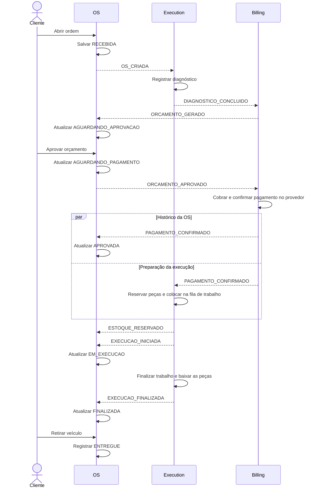

# SAGA da ordem de serviço

Na SAGA coreografada, o OS mantém a jornada e o histórico da ordem, o execution cuida do diagnóstico, do estoque e do trabalho, e o billing cuida do orçamento, do pagamento e do estorno. Cada serviço altera seu próprio estado e publica o resultado no seu tópico SNS.

## Tópicos, filas e eventos

Cada tópico SNS entrega todos os eventos que recebe às duas filas SQS assinantes. A tabela mostra os tipos que cada serviço deve tratar na sua fila, conforme o contrato da SAGA. O consumidor lê o campo `type` e ignora os tipos fora da sua responsabilidade.

| Serviço que publica | Tópico SNS | Fila SQS de destino | Serviço que consome | Eventos tratados nessa fila |
|---|---|---|---|---|
| `os-service` | `os-events` | `execution-service-os-events` | `execution-service` | `OS_CRIADA`, `OS_CANCELADA` |
| `os-service` | `os-events` | `billing-service-os-events` | `billing-service` | `ORCAMENTO_APROVADO`, `ORCAMENTO_REJEITADO`, `OS_CANCELADA` |
| `billing-service` | `billing-events` | `os-service-billing-events` | `os-service` | `ORCAMENTO_GERADO`, `PAGAMENTO_CONFIRMADO`, `PAGAMENTO_FALHOU`, `PAGAMENTO_ESTORNADO` |
| `billing-service` | `billing-events` | `execution-service-billing-events` | `execution-service` | `PAGAMENTO_CONFIRMADO`, `PAGAMENTO_ESTORNADO` |
| `execution-service` | `execution-events` | `os-service-execution-events` | `os-service` | `DIAGNOSTICO_CONCLUIDO`, `ESTOQUE_RESERVADO`, `EXECUCAO_INICIADA`, `EXECUCAO_FINALIZADA`, `EXECUCAO_FALHOU` |
| `execution-service` | `execution-events` | `billing-service-execution-events` | `billing-service` | `DIAGNOSTICO_CONCLUIDO`, `EXECUCAO_FALHOU` |

Ao publicar `OS_CRIADA` em `os-events`, o OS envia o evento às filas do execution e do billing via SNS. O execution abre o item de diagnóstico. O billing começa a calcular o orçamento quando recebe `DIAGNOSTICO_CONCLUIDO` em `billing-service-execution-events`.

### Envelope e reentrega

As filas seguem o padrão `<consumidor>-service-<produtor>-events`. O SNS entrega o JSON original, e cada fila tem uma DLQ com sufixo `-dlq`. O limite padrão é de cinco recebimentos antes do envio à DLQ. [Terraform da mensageria](../infra/mensageria.tf)

O envelope v1 tem `eventId`, `type`, `version`, `occurredAt`, `correlationId` e `payload`. Identifique a ordem em `payload.osId` e use o mesmo ID como texto em `correlationId`. Gere um UUID por evento e mantenha o mesmo `eventId` ao reenviar. [Contrato do OS](https://github.com/rafaelllsilva/tech-challenge-os-service/blob/fd2ed71/docs/CONTRATO-EVENTOS.md) · [Contrato do execution](https://github.com/theodirk21/tech-challenge-execution-service/blob/4908979/docs/EVENTOS.md)

Grave o evento de saída na outbox junto com a alteração de negócio. Como as filas podem reentregar mensagens ou entregá-las fora de ordem, deduplique por `eventId` e preserve os estados terminais.

## Fluxo principal

As setas entre serviços representam o processamento de eventos entregues via SNS → SQS. O diagrama mostra a sequência de negócio.

O OS registra diagnóstico e reserva no histórico. A criação do orçamento depende dos itens do diagnóstico enviados ao billing. A confirmação de pagamento chega ao OS e ao execution de forma independente.

## Falhas e compensações

| Situação | Ação esperada |
|---|---|
| Cliente rejeita o orçamento | O OS registra `CANCELADA` e publica `ORCAMENTO_REJEITADO` e `OS_CANCELADA` na mesma transação via outbox. Billing encerra o orçamento e trata eventual cobrança pendente. Execution cancela o trabalho e libera reservas aplicáveis. |
| Cancelamento antes da confirmação do pagamento | O OS publica `OS_CANCELADA`. Execution interrompe o trabalho pendente. Billing encerra a cobrança pendente e reconcilia eventual confirmação tardia. Se houver captura, trata a devolução como estorno. |
| Pagamento recusado | Billing publica `PAGAMENTO_FALHOU`. O OS registra a tentativa e volta a `AGUARDANDO_APROVACAO` enquanto houver tentativas disponíveis. No limite configurado, muda para `CANCELADA` e publica `OS_CANCELADA`. |
| Falta de estoque ou falha após pagamento | Execution registra `FALHOU`, libera reservas aplicáveis e publica `EXECUCAO_FALHOU`. Billing solicita estorno. O OS fica em `COMPENSACAO_PENDENTE` enquanto a devolução está em aberto. |
| Estorno confirmado | Billing persiste a confirmação do provedor e publica `PAGAMENTO_ESTORNADO`. O OS registra a devolução e fecha eventual pendência em `CANCELADA`. Execution cancela o trabalho pendente, libera reservas aplicáveis e mantém `FALHOU` quando o trabalho já falhou. |
| Estorno pendente ou com erro | Billing registra a pendência e reconcilia o resultado antes de repetir a operação. O OS permanece em `COMPENSACAO_PENDENTE`. |

Se o execution receber `OS_CANCELADA` antes de `OS_CRIADA`, deve preservar o cancelamento pelo ID da OS. Quando a criação atrasada chegar, ela deve respeitar a decisão já registrada. No billing, reentregas de eventos e notificações do provedor devem preservar um único efeito financeiro por pagamento e operação.

## Cenários de aceite

No teste relatado pelo grupo, `OS_CRIADA` da OS `16` chegou às filas do execution e do billing. Para validar o processamento ponta a ponta, use uma OS nova por cenário e compare os eventos publicados, os efeitos nos consumidores e o estado final da OS.

1. **Sucesso.** Abrir a OS, registrar o diagnóstico, aprovar o orçamento, confirmar o pagamento, reservar as peças e concluir a execução. Verificar `FINALIZADA` e depois `ENTREGUE`.
2. **Rejeição.** Rejeitar o orçamento e verificar que o billing o encerra uma única vez ao receber `ORCAMENTO_REJEITADO` e `OS_CANCELADA`. Verificar que o execution cancela o trabalho mesmo se `OS_CANCELADA` chegar antes de `OS_CRIADA`.
3. **Falha após pagamento.** Provocar falta de estoque ou falha de execução. Verificar as reservas aplicáveis e `COMPENSACAO_PENDENTE` até o estorno confirmado. Conferir `CANCELADA` e um único estorno mesmo com reentrega. Repetir com `EXECUCAO_FALHOU` chegando ao OS antes de `PAGAMENTO_CONFIRMADO`.

Para acompanhar cada cenário no New Relic, consulte a [convenção de observabilidade](convencao-observabilidade.md).
